# CONTEXTO MAESTRO — Plataforma con dos unidades de negocio

> **IngePresupuestos · Fork Em3rc0d · Contexto humano + IA · Versión documental 0.1**
>
> **Fecha de corte:** 2026-10-24 · **Estado:** definición de producto aprobada; arquitectura técnica detallada y SRS de Ventas **en diseño**; Ventas **no implementada**.
>
> **Fuente canónica de producto:** [ADR-002](ADR-002-DOS-UNIDADES-DE-NEGOCIO.md) · [MK0](MK0-VISION-Y-ALCANCE.md) · [MK1/SRS candidato](MK1-SRS-CANDIDATO.md) · [Contexto para agentes](CONTRATO-PARA-AGENTES.md).
>
> **Alcance operativo:** todo en [Em3rc0d/ingepresupuestos](https://github.com/Em3rc0d/ingepresupuestos). No contactar, crear PR ni modificar el proyecto de origen; conservar licencia GPL-3.0-or-later, avisos y autoría original.

## 0. Cómo usar este documento

**Lectura para personas:** secciones 1–4 (visión y diagramas) → 5–9 (módulos, reglas y experiencia) → 10–13 (implementación, viabilidad y pendientes).  
**Lectura para LLM/agentes:** leer primero la sección 2 (estatus y verdad), [ADR-002](ADR-002-DOS-UNIDADES-DE-NEGOCIO.md), secciones 6–8 (contratos/invariantes), 10–13 (gates), y luego [CONTRATO-PARA-AGENTES.md](CONTRATO-PARA-AGENTES.md).  
**Diagramas:** Mermaid dentro de Markdown, con fuente textual editable. GitHub los renderiza; si un visor Markdown no soporta Mermaid, los textos y tablas de cada sección son el equivalente accesible.  
**Nota editorial:** "debemos tener" describe el producto objetivo, **NO** funcionalidades listas; las etiquetas EXISTENTE / PROTOTIPO / DECIDIDO / PROPUESTO / ABIERTO / NO-IMPLEMENTADO son normativas.

## 1. En una página: qué estamos construyendo

**Una aplicación de escritorio local-first que contiene DOS unidades de negocio de primer nivel:**

- **BU-01 · Construcción (EXISTENTE):** se preserva íntegra la funcionalidad heredada de presupuestos de obra, análisis de costos unitarios (ACU), metrados, informes, cronogramas, control de obra, requerimientos y almacén de obra. No se convierte en un accesorio de Ventas.
- **BU-02 · Cotizaciones de Ventas (PROPUESTA APROBADA EN ALCANCE, NO IMPLEMENTADA):** un cotizador comercial de productos, servicios, materiales por medidas, paquetes, instalación y líneas personalizadas. Incluye catálogo de artículos, precios comerciales, clientes, revisiones, disponibilidad de inventario comercial y documentos.
- **Capacidades transversales:** navegación/configuración, matemáticas decimales, unidades, formato y exportación, persistencia local y respaldo, componentes UI reutilizables, trazabilidad; **se comparten solo si un contrato validado evita alterar reglas de cada BU**.

**Promesa candidata:** permitir a una empresa elaborar, revisar y explicar cotizaciones mixtas rápidamente, con cantidades medibles, precios versionados y disponibilidad identificable. **No hay validación de demanda pagadora todavía.**

La decisión de producto es construir **dos BUs hermanas**, no hacer una nueva aplicación web, no reemplazar Construcción y no desarrollar desde el inicio un ERP total.

### Gráfico 1 — Mapa de producto

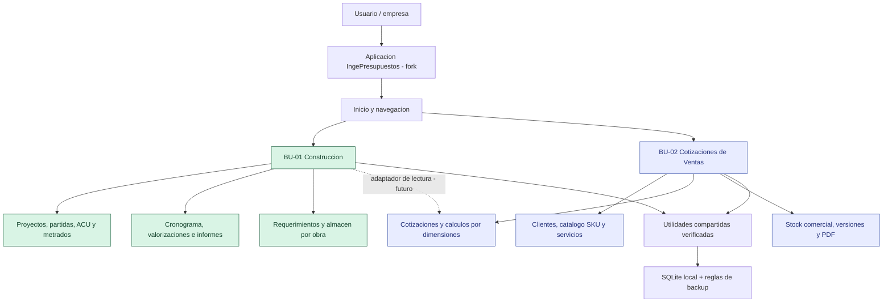

**Leyenda:** verde = capacidades de Construcción existentes; azul = capacidades previstas de Ventas. El nodo común representa **abstracciones propuestas**, no un paquete ya extraído. El camino punteado no existe en producción.

## 2. Estado real, evidencia y autoridad de las decisiones

| Tema | Estado | Evidencia / interpretación correcta |
|---|---|---|
| Framework desktop | **EXISTENTE** | Python + PySide6/Qt, entrada `main.py`; no frontend web |
| BD actual | **EXISTENTE** | SQLite local, `core/config.py` + `core/database.py` |
| Construcción | **EXISTENTE con QA parcial** | `core/database.py`, `views/proyecto_view.py`, `views/metrados_view.py`, `core/requerimientos.py`, `core/almacen.py` |
| Precio por proyecto / ACU | **EXISTENTE** | `_recalcular_pu`, `get_acu_items`, `precio_recurso_en_proyecto`; no reutilizar precio como venta automáticamente |
| Stock de obra | **EXISTENTE** | `almacen_ingreso` menos consumo de `parte_diario_recurso`, por `proyecto_id`, no stock comercial |
| Motor cantidades paramétricas | **PROTOTIPO** | [PR #1](https://github.com/Em3rc0d/ingepresupuestos/pull/1), `core/acu_parametrico.py`; 17 tests puros, no UI/DB/precio |
| Estabilización del fork | **EN REVISIÓN** | [PR #3](https://github.com/Em3rc0d/ingepresupuestos/pull/3) en borrador; Linux y Windows con incidentes Qt/CI pendientes |
| Arquitectura de 2 BUs | **DECIDIDA** | [ADR-002](ADR-002-DOS-UNIDADES-DE-NEGOCIO.md), sin obligación de reescritura |
| BU Cotizaciones de Ventas | **NO IMPLEMENTADA** | [SRS candidato](MK1-SRS-CANDIDATO.md) RF-001 a RF-035; no migraciones aún |
| Shared kernel técnico | **DISEÑO CANDIDATO** | Funciones candidatas verificadas por lectura de código; extracción todavía no realizada |
| Ventas vía navegador/SaaS | **FUERA DEL MVP** | Puede evaluarse si usuarios reales validan colaboración, sincronización y negocio |
| Canal de release propio | **ABIERTO** | Evitar URLs/secrets/publicaciones heredadas; QA y derechos de datos antes de distribuir |
| Viabilidad comercial | **NO VALIDADA** | Sin entrevistas pagadoras ni prueba de márgenes/retención verificadas en este expediente |

**Baseline verificable:** [Auditoría 2026-10-24](../auditorias/AUDITORIA_TECNICA_2026-10-24.md) registró 392 aprobadas/17 fallidas/6 omitidas en base y 409/17/6 con spike: **mismas 17 fallidas**, 17 casos nuevos aprobados. Esto **no** equivale a certificación general del sistema. Windows pasó 40 tests críticos existentes + 17 nuevos en smoke de esa auditoría; PR #3 sigue sin cierre total.

### Gráfico 2 — La decisión no elimina Construcción

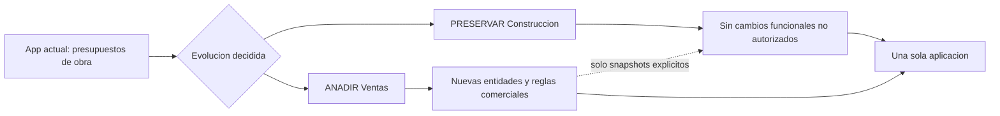

## 3. Alcance funcional completo de las BUs

### 3.1 BU-01 · Construcción (preservar)

Esta BU conserva los módulos heredados y su semántica: proyectos/subpresupuestos, árbol de partidas, metrado por dimensiones y acero, ACU con mano de obra/materiales/equipos/subcontratos, catálogo de insumos y biblioteca de costos unitarios, precios por proyecto, resumen y pie, programación de obra/Gantt/ruta crítica, valorizaciones/curva S, fórmula polinómica e índices INEI, reportes PDF/Excel/Word/ODS/ODT donde ya existan, importaciones de formatos soportados, requerimientos, almacén/kárdex por obra y funciones complementarias ya incluidas.

**Preservar** no significa declarar que toda capacidad está validada: debemos mantener pruebas de regresión del comportamiento existente, priorizando creación/edición/guardado/reapertura/exportación. El código `views/proyecto_view.py` es muy grande (aprox. 15 mil líneas) y debe tocarse de modo localizado.

**Evolución opcional (PR #1):** asistente de generación de cantidades por parámetros geométricos que se conecta al ACU sin sustituir su motor económico. Sigue fuera del flujo comercial hasta tener su propio gate.

### 3.2 BU-02 · Cotizaciones de Ventas (objetivo funcional)

| Módulo propuesto | Incluye | Por qué lo necesitamos | MVP / posterior |
|---|---|---|---|
| Clientes | Datos de contacto, direcciones comerciales, documento opcional, condiciones, historial | Identificar destinatario y recuperar propuestas | MVP mínimo |
| Catálogo de ventas | Producto/SKU, variantes, servicio, unidad, costo opcional, precio de venta, estado | Insertar artículos sin reescribir líneas | MVP |
| Precios | Lista base, overrides controlados, moneda, descuento, precio histórico | Ofertas consistentes sin confundir costo/venta | MVP básico |
| Cotizaciones | Numeración, versiones, vigencia, estado, líneas mixtas, condiciones | Documento comercial real | MVP |
| Cálculo dimensional | Longitud, superficie, volumen, cobertura, presentación, rendimiento y supuestos | Cotizar metraje sin cálculos ocultos | MVP acotado |
| Stock comercial | Entradas, salidas, ajustes; físico, reservado, disponible y faltante | Informar si podemos atender una venta | MVP mínimo condicionado |
| Paquetes | Producto + material + mano de obra + instalación y transporte | Cotizaciones mixtas | MVP simple |
| Documentos | Vista previa, PDF, exportación tabular y congelación de revisión | Envío comercial coherente | MVP |
| Historia/auditoría | Diferencias entre versiones, autor, motivo, instante, precios congelados | Evitar retrabajo y discusiones por cambios | MVP |
| Compras/proveedores | Orden de compra, abastecimiento, recepción | Operación posterior | Fase futura |
| Pedidos y despacho | Conversión a pedido, reserva, remito/entrega | Ejecutar una venta | Fase futura |
| Facturación/SUNAT | Comprobantes y obligaciones tributarias | Cumplimiento legal | Fuera de MVP, investigar |
| SaaS / multiusuario web | Cuenta, API, sincronización, roles remotos | Colaboración entre equipos | Posterior a validación |

No confundir "compatible con todos los rubros" con desarrollar simultáneamente todas las reglas. La arquitectura es general; la primera prueba comercial debe concentrarse en un segmento.

## 4. Arquitectura técnica objetivo

### Gráfico 3 — Contextos y dependencias permitidas

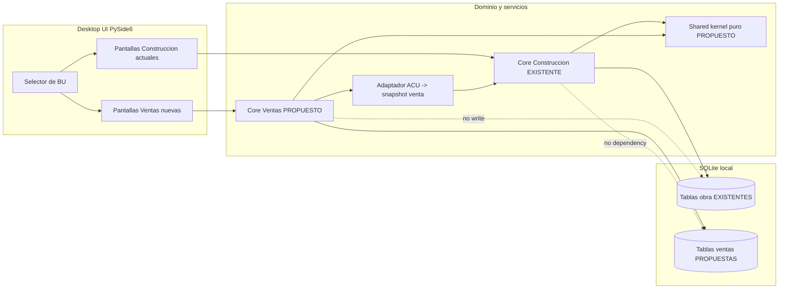

**Regla arquitectónica:** Ventas puede solicitar una lectura a Construcción a través de un adaptador tipado que congela los datos. Nunca escribir en tablas de Construcción desde comandos de Ventas. Las BUs pueden compartir el **mismo archivo físico SQLite inicialmente**, pero con tablas propias y migraciones separadas. Esta decisión de archivo compartido es una **recomendación**, su contrato final no está aprobado.

### Gráfico 4 — Dependencia evolutiva de código

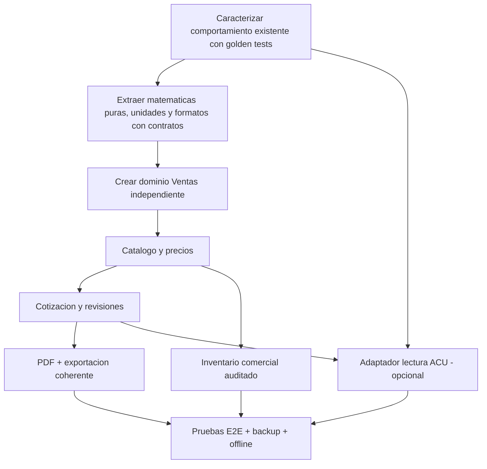

**Objetivo de reusable code:** compartir algoritmos validados, no vistas enormes ni funciones con efectos secundarios. Si un cálculo heredado usa `float` y el comercial requiere `Decimal`, crear un primitivo nuevo y comparar resultados; no cambiar unilateralmente la política de redondeo de Construcción.

### Mapa de reutilización — qué conservar y qué construir

| Activo existente | Uso nuevo posible | Condición de aceptación |
|---|---|---|
| `core/database.py` (funciones de ACU y PU) | Costo técnico de obra como **origen** de una línea comercial | Solo lectura, snapshot, precio comercial independiente |
| `core/database.py` (`_r2`, `_rn`, `cantidad_acu`) | Estudio del criterio HALF_UP | Golden tests antes de introducir `Decimal` puro para moneda |
| `views/metrados_view.py` | Matemáticas de longitud/área/volumen | Extraer helpers puros sin acoplar la vista |
| `core/almacen.py` | Modelo mental de kardex y movimientos | Construir ledger comercial separado, por SKU/variante |
| `core/requerimientos.py` | Ideas para acumulados/consumos | Nunca convertir requerimiento de obra en orden comercial automática |
| `utils/formatting.py` | Presentación de números/moneda | Probar formatos, locales, separadores y redondeos |
| Exportadores existentes | Motor de render/export genérico | PDF/XLSX de Ventas idéntico al documento emitido |
| Widgets y temas Qt | Controles visuales | Accesibilidad, estados y responsive de ventana comprobados |
| `core/acu_parametrico.py` en PR #1 | Motor puro de cantidades | Aprobación de fórmulas, unidades, adaptadores, sin integrarlo directo |

## 5. Mapa de interfaz y experiencia (diseño, no capturas)

### Gráfico 5 — Mapa de navegación propuesto

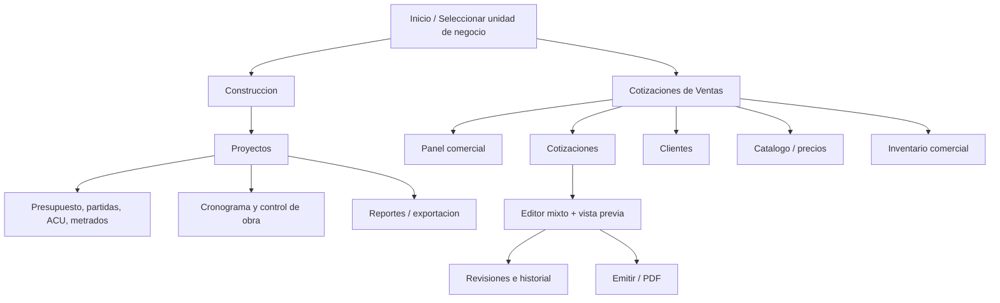

**Inicio:** entrada visible a ambas BUs; no forzar a un vendedor a crear un proyecto de construcción.  
**Construcción:** preservar navegación anterior sin reentrenamiento de usuarios.  
**Ventas:** cotizaciones recientes y pendientes, acceso a clientes, catálogo, inventario y una acción principal para crear propuesta.  
**Editor de cotización:** encabezado comercial → búsqueda/creación de líneas → método de cálculo por línea → disponibilidad → descuentos/tributos → importe y advertencias → vista previa → emisión.  
**Accesibilidad:** control con teclado, foco predecible, lector de pantalla, mensajes de validación, contraste, zoom y ventanas redimensionables. La navegación propuesta necesita especificación UX y pruebas PySide6; no existe UI entregada.

### Gráfico 6 — Recorrido del usuario de Ventas

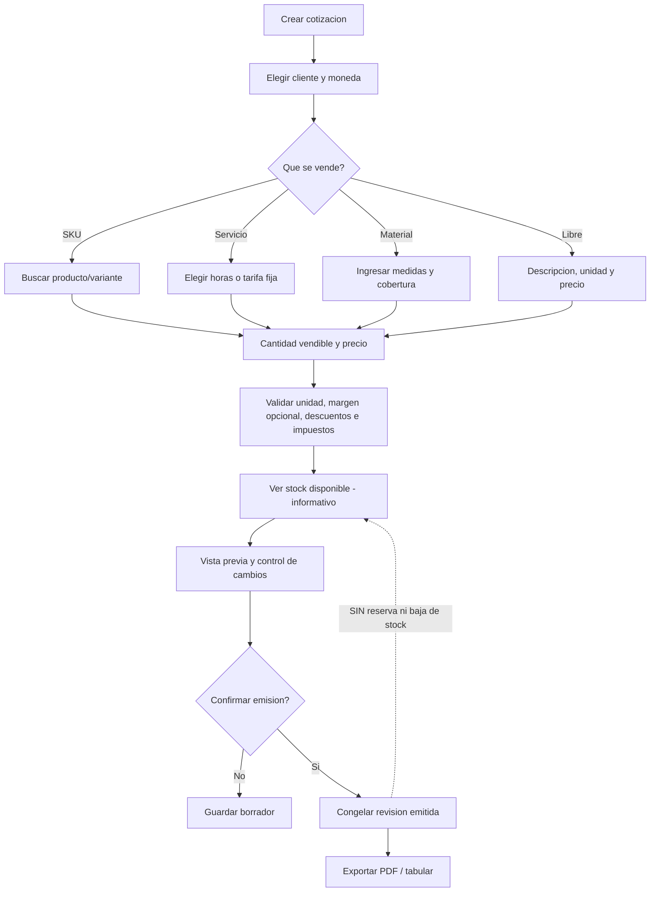

## 6. Modelo de información (conceptual, NO esquema aprobado)

El modelo de Ventas se diseña separado del heredado. Los nombres `ventas_*` son **propuestos**, no migraciones existentes.

### Gráfico 7 — Modelo entidad-relación conceptual de Ventas

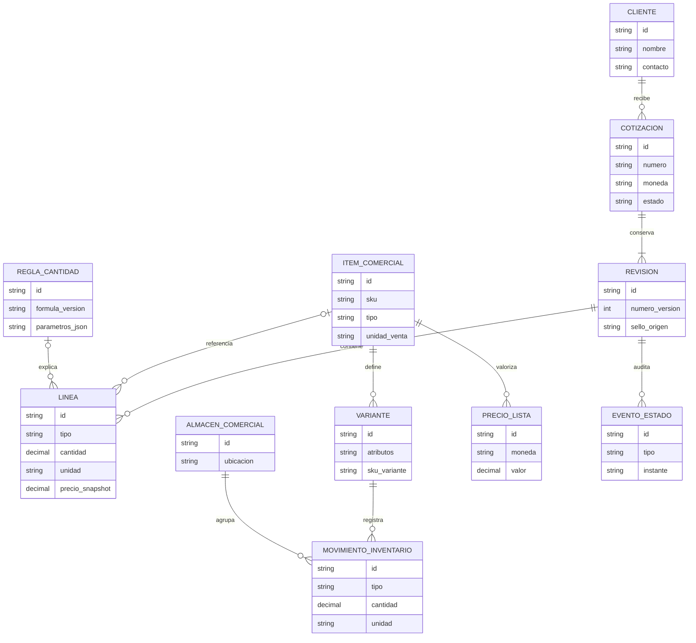

**Aclaraciones de diseño:** Cardinalidades del gráfico ilustran las relaciones deseadas, **no contratos finales**. `REVISION` debe admitir borradores vacíos antes de agregar líneas: ajustar cardinalidad si se modela así. Una variante puede tener identidad vendible independiente del producto; el stock debe contarse en una unidad física canónica y convertirse a presentación con reglas comprobables. La representación textual `decimal` no define aún escala SQL. Ni esta ERD ni sus campos autorizan `CREATE TABLE` sin cierre de MK1.

### Agregados con dueño

| Agregado | BU responsable | Identificador | Restricción |
|---|---|---|---|
| Proyecto / Partida / ACU | Construcción | `proyecto_id`, `partida_id`, `recurso_id` | No escribir desde Ventas |
| Stock obra | Construcción | `proyecto_id` + recurso | No sumar al stock comercial |
| Cotización / Revisión | Ventas | ID propio, número visible por emisor | Revisión emitida inmutable |
| Línea comercial | Ventas | ID + revisión | Precio y unidad congelados |
| Catálogo comercial | Ventas | SKU + variante según contrato | Distinto de `recursos` |
| Inventario comercial | Ventas | SKU/variante + almacén + movimiento | Cotización no causa movimiento |
| Regla de cantidades | Shared o propietario específico | ID y versión | Fórmula pura, evaluable y explicable |
| Snapshot desde ACU | Ventas, origen Construcción | ID origen + fingerprint | Solo lectura / procedencia |

## 7. Reglas matemáticas, de stock y económicas

### 7.1 Cantidades medidas, consumidas y comercializadas NO son iguales

Ejemplo sintético: superficie **120 m²**, **2 manos**, cobertura **8 m²/L por mano**, consumo adicional **10 % sobre el teórico**.

- Consumo teórico: `120 × 2 / 8 = 30 L`.
- Consumo previsto: `30 × (1 + 0.10) = 33 L`.
- Presentación comercial hipotética de **4 L por envase**: `ceil(33/4)=9 envases`.
- Litros equivalentes vendidos/comprados: `9×4=36 L`; los 3 L restantes no equivalen automáticamente a "merma".
- Existencia disponible hipotética: **6 envases**; requeridos **9**; **faltan 3**. Emitir cotización no reduce los 6 envases existentes.

**Importante:** cobertura y merma son supuestos de demostración, no ficha técnica real; nunca asumir conversiones kg ↔ L o área ↔ pintura sin fuente y condiciones.

### Gráfico 8 — Cómo se determina stock disponible (propuesta)

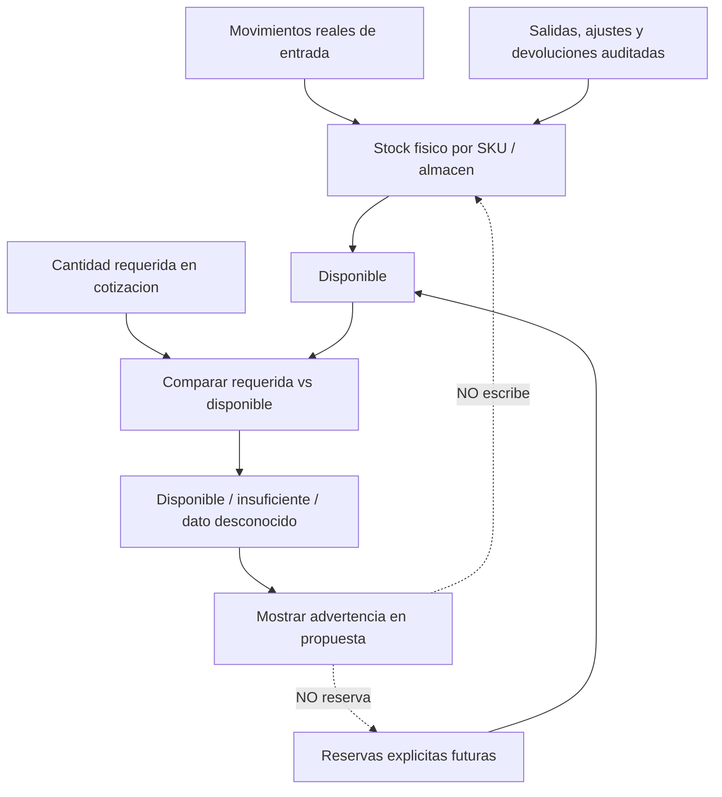

`Stock disponible = stock físico − reservado`, **solo** si existe un ledger que implemente reservas; `faltante=max(0,requerido−disponible)`. Si el inventario se mantiene manualmente o no está sincronizado, mostrar "disponibilidad referencial" o "no verificada", no "stock real". Una salida/ajuste requiere evento autorizado independiente de cotizar o aceptar.

### 7.2 Costo ≠ precio de venta ≠ tributo ≠ rentabilidad

- **Costo técnico de obra:** resultado de `_recalcular_pu`, recursos/precios propios del proyecto; se usa como referencia, no como lista comercial.
- **Costo comercial:** costo de adquisición/servicio (puede ser desconocido).
- **Precio de venta:** tarifa aprobada o introducida por el cotizador con regla y fecha; no se deduce mágicamente del costo.
- **Markup:** `(precio - costo) / costo` cuando costo > 0.
- **Margen:** `(precio - costo) / precio` cuando precio > 0.
- **Descuentos/tributos:** orden de cálculo, tasa/condición, inclusividad y redondeo deben configurarse/documentarse; no asumir tratamiento tributario único para Perú u otros países.
- **Históricos:** un cambio de lista de precios no altera el valor de una revisión comercial emitida.
- **Aritmética:** `Decimal` en el dominio nuevo, cantidad tipada, moneda explícita, redondeo determinista. No cambiar funciones financieras heredadas hasta tener oráculos de compatibilidad.

### Gráfico 9 — Preservación al reutilizar un ACU en una venta

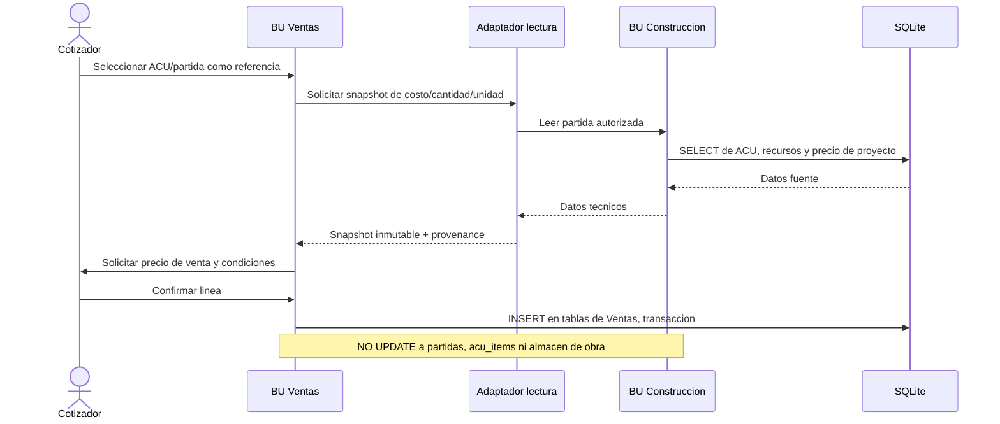

Esta interoperabilidad es **posterior al MVP mínimo si el piloto no la exige**. Debe probarse con hash/estado previo y posterior de Construcción para detectar cualquier mutación accidental.

## 8. Ciclo de vida de cotización y control de cambios

### Gráfico 10 — Máquina de estados comercial

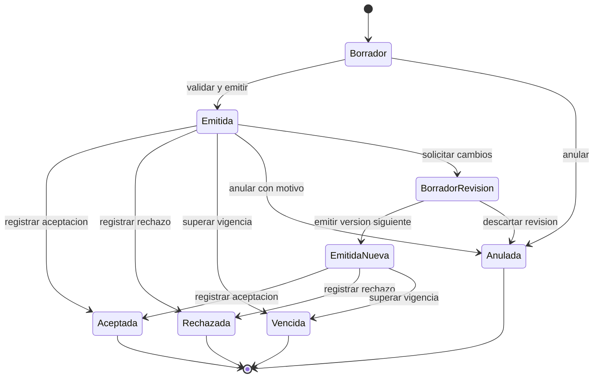

El gráfico es **candidato**. Se debe definir qué significa aceptar una revisión cuando existen varias emitidas, si la nueva versión sustituye la anterior y si una oferta vencida puede reabrirse mediante nueva versión. **Nunca editar en sitio** una cotización ya emitida; almacenar cambios como revisión con motivo/fecha. Aceptada no implica automáticamente factura, movimiento de almacén ni documento legal.

**Flujo mínimo de revisión:** duplicar snapshot anterior a borrador de revisión → editar líneas/cantidad/precio/condiciones → calcular diferencia (antes/después) → validar permisos/descuentos → confirmar versión nueva → guardar en transacción → exportar versión concreta.

## 9. Escenarios reales que la arquitectura debe admitir

| Caso de uso | Líneas y método | Punto crítico |
|---|---|---|
| Pinturas | envases, diluyente, rodillos, aplicación en m², transporte | consumo vs unidad vendible y faltante de stock |
| Vidriería / metal | área/longitud, pieza, herraje, colocación | m² y unidades discretas no se suman físicamente |
| Carpintería/melamina | tablero, canto, herrajes, instalación | material por medidas y mermas configurables |
| Taller/mantenimiento | repuestos SKU, servicio, diagnósticos tarifados | productos y mano de obra comercial separados |
| Consultoría TI | horas, licencias, soporte, hardware | servicio no necesariamente tiene inventario |
| Obra/instalación | partidas ACU, materiales vendidos, flete, mano de obra | costo técnico ≠ precio final, snapshot desde Construcción |
| Mayorista | docenas, cajas, unidades, descuentos | unidad stock vs unidad precio, vigencia |
| Cotización libre | descripción manual, cantidades, precio | no obligar al usuario a crear SKU para cada trabajo |

Estos son **escenarios de aceptación**, no segmentos con mercado validado. Marketing/comercial debe elegir un público inicial y comparar alternativas actuales con evidencia.

### Gráfico 11 — Dos flujos independientes pero comunicables

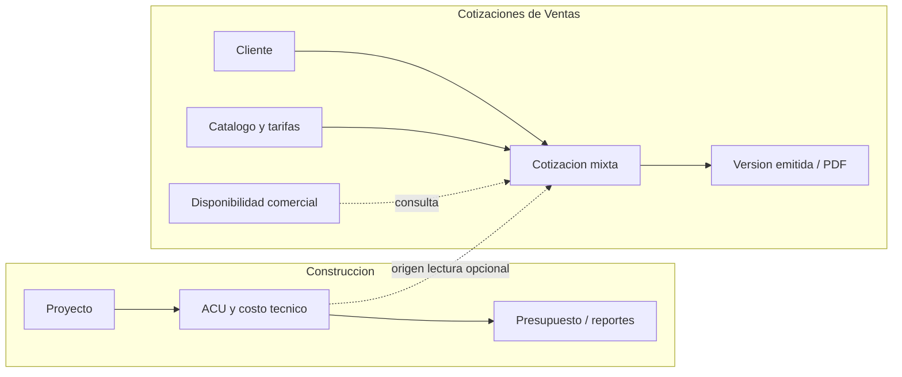

## 10. Seguridad, calidad y contratos no negociables

### Invariantes

**INV-01** Construcción opera y guarda proyectos aunque Ventas no esté inicializada o falle.  
**INV-02** Crear/modificar/emitir cotización no escribe `proyectos`, `partidas`, `recursos`, `acu_items`, `almacen_ingreso` o `parte_diario_recurso`.  
**INV-03** Precio de venta y costos de obra nunca se confunden; snapshot+origen explícito.  
**INV-04** Cantidad medida, cantidad consumida y unidades vendibles/stock se distinguen siempre.  
**INV-05** Cotizar, emitir, exportar o registrar aceptación no crea reservas ni movimientos.  
**INV-06** Las revisiones emitidas son inmutables e idénticas entre UI, DB y PDF.  
**INV-07** Identidades de SKU/variante y `recurso_id` de obra están separadas; no se usan IDs de una BU en otra sin mapeo.  
**INV-08** No usar fórmulas con `eval`, inputs no verificados, valores `NaN`/infinito, dimensiones incompatibles o costos inventados.  
**INV-09** Cada migración de Ventas es transaccional/idempotente o tiene recuperación y backup probados; nunca destruye datos antiguos.  
**INV-10** Ninguna tarea/actualizador del fork escribe o publica en infraestructura del original. No comunicación al proyecto de origen.  
**INV-11** Sin calificar como producción/legal/comercialmente validado un flujo sin pruebas/contratos/evidencia.  
**INV-12** Archivo SQLite local-first, sin backend/LLM obligatorios para operar la BU Construcción y el futuro MVP de Ventas.

### Requisitos de calidad que debemos medir

| Calidad | Criterio verificable propuesto | Situación |
|---|---|---|
| Correctitud de importes | tests monetarios Decimal HALF_UP, descuentos e impuestos con golden fixtures y export idéntico | ABIERTO |
| Compatibilidad Construcción | suites críticas + comparativa DB/ACU antes/después + cero mutación cross-BU | BASELINE parcial existente |
| Atomicidad | falla forzada durante guardar cotización o inventario produce rollback | ABIERTO |
| Stock | ledger conciliable, cero negativos no autorizados, timestamp y motivo | ABIERTO |
| Rendimiento | catálogo objetivo 5.000 SKU y cotización 200 líneas sin bloqueo perceptible; medir en PC objetivo | OBJETIVO, no demostrado |
| Disponibilidad offline | abrir, cotizar, guardar y exportar sin red | ABIERTO |
| UX/Accesibilidad | teclado, zoom, estados, feedback, evitar pérdida accidental | ABIERTO |
| Integridad seed | `PR #3` comprobó SQLite estructural; contenido podría contener campos reales | PARCIAL — privacidad pendiente |
| Build Windows | smoke Py3.12 crítico previo PASS; instalador derivado no certificado | PARCIAL |
| Distribución | GPL/Qt LGPL, inventarios de terceros y branding legal revisados | ABIERTO |
| Seguridad y privacidad | backups, restauración, cifrado cuando corresponda, separación de clientes, política de sesiones | ABIERTO |

## 11. Entregas por etapas: de documentos a sistema utilizable

### Gráfico 12 — Ruta MK y gates, sin saltarse decisiones

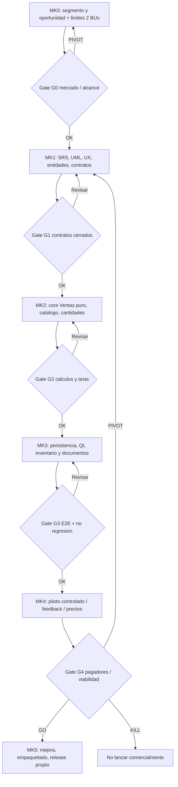

**En paralelo:** estabilizar Construcción y el entorno Qt/SQLite desde [PR #3](https://github.com/Em3rc0d/ingepresupuestos/pull/3). No bloquear *diseño* de Ventas por toda la deuda técnica, pero sí bloquear migraciones integradas y release si falta baseline confiable. No confundir el PR #1 de matemáticas de ACU con la primera versión comercial.

### Hitos mínimos por MK

| Etapa | Qué debemos producir | Condición de salida |
|---|---|---|
| MK0 | contraste de alternativas, segmento objetivo inicial, disposición de pago, oportunidad real | GO/PIVOT/KILL documentado; sin cifras inventadas |
| MK1 / diseño | caso de uso, escenarios, mapa de navegación, API interna, decisiones de inventario/ventas | todos los nodos críticos del grafo cerrados |
| MK1 / arquitectura | ERD definitivo, migraciones versionadas, secuencias, ACU adapter, golden test suite | contratos firmes, reversibles y verificados |
| MK2 / núcleo | catálogo, tipos, cantidades, precios, moneda, taxes/discount rules puros | pruebas paramétricas + propiedades + invariantes |
| MK3 / aplicación | ventas Qt, guardar/abrir, inventario básico si aprobado, PDF/XLSX | transacciones + pruebas e2e offline y accesibilidad |
| MK4 / validación | pilotos y correcciones observables | mejora medida + usuarios reales + revisión de precio |
| MK5 / distribución | empaquetado Windows, derechos/avisos, updater propio, smoke en instalación limpia | decisión explícita de release y mantenimiento |

## 12. Escenarios end-to-end que no pueden faltar

**E2E-01 — Construcción permanece intacta:** abrir un proyecto antiguo, editar ACU, recalcular, metrar, generar resumen y exportar; comparar contra golden fixture conocido.  
**E2E-02 — Cotización simple:** nuevo cliente, SKU x 3, servicio x 5 h, descuentos y subtotal; guardar/abrir/emitir/exportar, mismo importe.  
**E2E-03 — Medición y presentación:** 120 m² pintura, 33 L previstos y 9 envases de 4 L, mostrar diferencia y origen de variables.  
**E2E-04 — Stock insuficiente:** seis envases disponibles, requiere nueve; mostrar falta tres; emitir/aceptar sin alterar ledger.  
**E2E-05 — Revisión:** emitir V1, cambiar tarifa/lista, proponer V2; V1 sigue idéntica y exportable.  
**E2E-06 — Cruce Construcción → Ventas:** leer ACU, elegir precio de venta, congelar snapshot; DB obra sin cambios, incluso con rollback provocado.  
**E2E-07 — Error de persistencia:** simular caída/SQLite bloqueado en mitad de transacción, no dejar cabecera sin líneas o ledger inconsistente.  
**E2E-08 — Actualizar el software:** backup, aplicar migración, reabrir proyectos y cotizaciones sin cambiar importes históricos.  
**E2E-09 — Sin red:** crear/guardar/editar/exportar cotización sin proveedores remotos.  
**E2E-10 — Regresión y roles:** cotizador no cambia stock sin flujo de inventario; Construcción sin acceso a tablas comerciales por accidente.

## 13. Decisiones pendientes — lista explícita que otro agente NO debe asumir

| ID | Decisión pendiente | Hipótesis inicial (NO aprobada) | Impacto |
|---|---|---|---|
| D-01 | Segmento comercial piloto | Distribuidores de pinturas/materiales o talleres con cotizaciones por metraje | Marketing, plantillas |
| D-02 | Stock comercial v1 | Un almacén local con movimientos, sin reserva automática | Modelo/UX |
| D-03 | Política de cliente / numeración | Código de cotización por emisor y secuencia anual | DB/colisiones |
| D-04 | Moneda e impuestos | Moneda por documento y tasas snapshot configurables | Cálculo/ley |
| D-05 | Precios/tarifas | Lista base + override con motivo; costo opcional | Seguridad/margen |
| D-06 | Cotizaciones mixtas | Líneas libres+SKU+servicio+material dimensional | UX/ER |
| D-07 | Roles/autenticación | Solo local inicialmente; acciones sensibles restringidas | Seguridad |
| D-08 | Alcance ACU→Venta | Adaptador solo lectura como extensión posterior | Integración |
| D-09 | Configuración de DB | Un archivo SQLite + tablas `ventas_*` aisladas | Migraciones |
| D-10 | Plataforma futura | Desktop-first, core portable; web no comprometida | Costos |
| D-11 | Identidad/marca del fork | Nombre propio diferenciable, GPL y atribuciones conservadas | Distribución |
| D-12 | Soporte y monetización | Validar servicio especializado vs producto de pago | Viabilidad |

**Cada decisión debe cerrarse con:** alternativas, trade-offs, fuente/evidencia, responsable, impacto RF/RNF, estado, decisión final y prueba correspondiente. No rellenar "aprobado" porque un modelo lo sugirió.

## 14. Reglas para agentes de IA y trazabilidad

1. **Leer** el estado de GitHub del fork antes de escribir; usar `main` solo para baseline. Los PR #1 (ACU), #3 (estabilización) y #4 (diseño) son independientes; nunca fusionarlos por conveniencia.
2. **No inferir implementaciones** de este documento: los diagramas 3–12 describen objetivo/arquitectura propuesta y sus dependencias, no código ejecutado.
3. **Provenance tags**: `EXISTENTE/OBSERVED` (archivo real), `DECIDIDO/OFFICIAL` (decisión explícita), `INFERRED` (propuesta razonable sin validación), `PROTOTIPO` (aislado), `GENERATED` (fixtures), `ABIERTO` (decisión pendiente).
4. **No crear código** de Ventas ni migraciones hasta cerrar D-02–D-09 y gates de MK1; sí se permite mejorar especificaciones, caracterizar APIs y preparar pruebas puras sin alterar producción, con scope explícito.
5. **No degradar** Arquitectura de Construcción ni sus cálculos por simplificar Ventas.
6. **No contactar** autor, repositorio ni comunidad original. No reutilizar su R2, tiendas, claves, dominio o actualizador para la versión derivada.
7. **No publicar** APK, AppImage, Flatpak, Windows Installer ni releases hasta que haya QA, permisos, branding y derechos de datos comprobados. Tampoco usar Actions solo para publicación mientras queden blockers.
8. **Mantener diferenciación entre hecho y aspiración.** Si no hay evidencia, marcar explícitamente `NO VERIFICADO`.
9. **Documentar pruebas reproducibles** (comandos, OS, Python, Qt, sha, fixtures, logs, cobertura y fallos) y no considerar 17 tests puros como integración aprobada.
10. **Licencia**: preservar GPL y copyright de terceros, no presentar el trabajo derivado como autorizado/oficial por productor original.

### Fuentes internas / orden de autoridad

1. Instrucción explícita reciente del propietario y ADR-002 (arquitectura BU) — **prioridad producto**.
2. Código en `main` (hechos existentes) y auditoría técnica — **prioridad técnica de estado**.
3. SRS `MK1-SRS-CANDIDATO.md` — **requisitos propuestos**, nunca implementados por el hecho de estar escritos.
4. `MK0-VISION-Y-ALCANCE.md` — mercado y hipótesis (no ventas ni rentabilidad confirmadas).
5. PR #1 para motor ACU, PR #3 para estabilización, PR #4 para diseño — cada uno con **su propio gate**.
6. Cualquier documento previo que contradiga las dos BUs hermanas queda supersedido por ADR-002.

---

**Resumen legible:** mantenemos todo lo útil y específico de Construcción, añadimos una segunda BU comercial con catálogo, metraje, productos, servicios, stock y cotizaciones versionadas, y compartimos exclusivamente lógica pura probada. **Diseñar ambas BUs de forma modular no equivale a tenerlas implementadas ni económicamente validadas.**