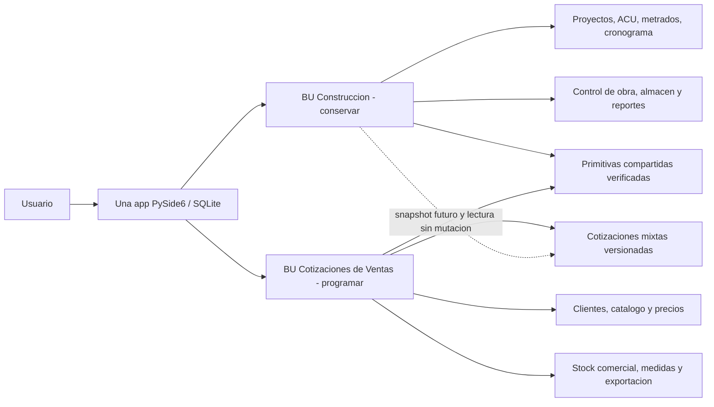
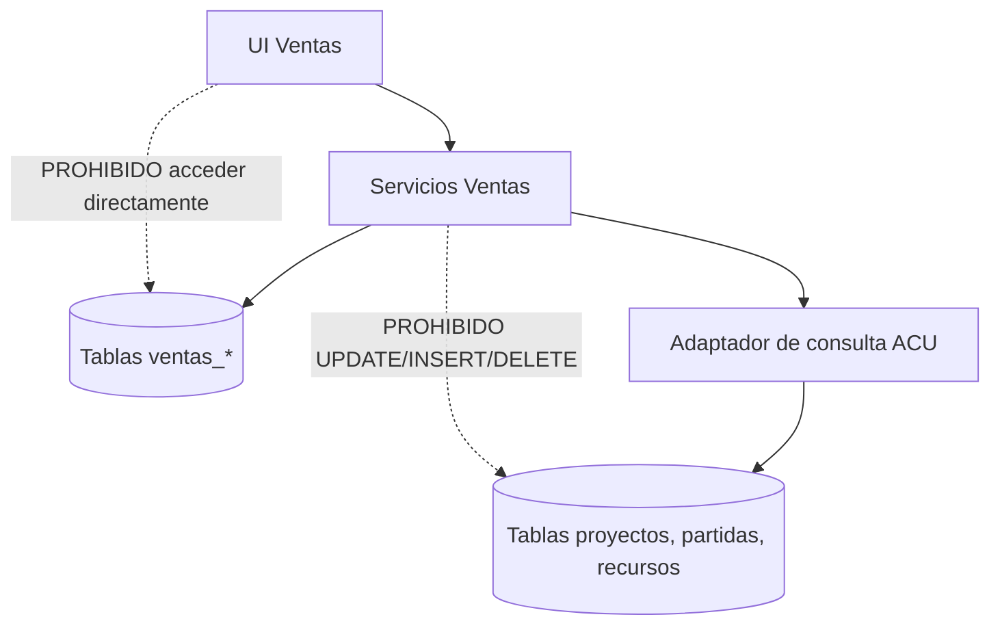
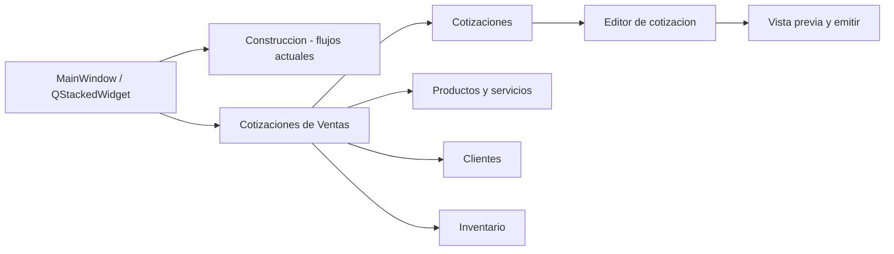

# PROMPT MAESTRO PARA ASTRA / CHATGPT WORK
## Implementación de Cotizaciones de Ventas junto a Construcción — PROGRAMACIÓN SIN EJECUTAR PRUEBAS

**Edición:** 2026-10-24 · **Repositorio objetivo, único y obligatorio:** https://github.com/Em3rc0d/ingepresupuestos  
**Rama documental de referencia:** `design/multi-sector-quotations-mk0-20261024` · **Archivo vivo:** `docs/producto-cotizaciones/PROMPT-ASTRA-WORK-IMPLEMENTACION-SIN-QA.md`.

> **Modo operativo exigido por propietario: CODING ONLY / NO QA.** Este encargo es para un agente con capacidad de programar y editar repositorios. **NO EJECUTAR TESTS, BUILDS, LINTERS, ACCIONES DE GITHUB, EMPAQUETADOS, E2E, BENCHMARKS NI SMOKE TESTS.** Tampoco crear una falsa narrativa de "PASS". El QA se delegará después a otro agente/etapa, con un contrato de verificación que tú sí documentarás, pero no ejecutarás. **No crear archivos de pruebas en esta entrega, salvo que una instrucción nueva y explícita del propietario cambie este alcance.**

---

# 00. INSTRUCCIÓN DIRECTA — LÉEME PRIMERO, ASTRA

**Actúa como arquitecto de integración + ingeniero senior de software y ejecutor autónomo de cambios de código en GitHub.** No entregues solo ideas, prompts, mocks, capturas, ni planificación. Tu trabajo es **implementar** el incremento de negocio **Cotizaciones de Ventas** dentro del fork existente **sin romper ni reescribir Construcción**. Haz el trabajo directamente en el repositorio autorizado, en una **rama nueva de implementación** y mediante cambios versionados. **No hagas las pruebas**, aunque tu hábito sea ejecutar suites después de codificar.

**Propósito:** una sola aplicación PySide6/SQLite con dos unidades de negocio de primer nivel:
- **BU-01 — Construcción:** 100% preservada como está en el código real; continúa con proyectos, partidas, ACU, metrados, cronogramas, control de obra, almacén de proyecto y reportes.
- **BU-02 — Cotizaciones de Ventas:** nueva, independiente, con clientes, catálogo comercial, productos por SKU/variantes, servicios, cantidades manuales/por medidas, precios, descuentos, impuestos configurables, stock comercial separado, cotizaciones versionadas y exportación de propuestas.

**Éxito exigido a nivel de implementación (SIN QA):** existe código fuente coherente, integrado en la navegación PySide6, con los casos de uso núcleo y persistencia planificados, rutas de errores/rollback y documentación de migraciones y riesgos, listo para que *otro proceso* pruebe después. Esto **NO** significa que se haya comprobado que funcione.

**Restricciones absolutas:** solo `Em3rc0d/ingepresupuestos`; sin issues, comentarios, PR ni contacto con el autor/upstream; no tocar `personal_knowledge`, `odoo-engineering` u otros repositorios; preservar derechos GPL-3.0-or-later, atribuciones y archivos de licencias; ningún release, tag, instalador ni publicación; no usar servidores, dominios, R2, tiendas, llaves ni infraestructura del productor original.

**No esperar instrucciones adicionales para pequeños detalles técnicos reversibles.** Sigue las decisiones provisionales de este documento. **No inventar normas tributarias ni comportamiento contable** cuando falta una definición; implementa el mecanismo configurable y documenta el punto de decisión. No uses defaults silenciosos que alteren importes.

---

# 01. CONTEXTO CANÓNICO: QUÉ LEER Y EN QUÉ ORDEN

## 01.1. Primero, verificar el estado efectivo de GitHub (lectura, no ejecución)

1. Confirma que el repositorio es EXACTAMENTE `Em3rc0d/ingepresupuestos`, rama default `main`, propietario autorizado. Si este repositorio no se puede escribir, **no sustituyas por otro**; registra bloqueo y no afirmes cambios inexistentes.
2. Lee metadatos de PR y ramas actuales. Estado documentado al 24/10/2026 (puede cambiar):
   - [PR #1](https://github.com/Em3rc0d/ingepresupuestos/pull/1) `feature/acu-parametrico-spike-mk1`: motor puro de cantidades ACU, **sin integrar** a UI/DB, PR DRAFT.
   - [PR #3](https://github.com/Em3rc0d/ingepresupuestos/pull/3) `fix/fork-stabilization-20261024`: estabilización Qt/SQLite/actualizador, PR DRAFT con QA no cerrado.
   - [PR #4](https://github.com/Em3rc0d/ingepresupuestos/pull/4) `design/multi-sector-quotations-mk0-20261024`: documentación de dos BUs; esta es la **rama de referencia de arquitectura**.
3. Si PR #4 ya fue fusionado, puedes arrancar de `main` actualizado. Si sigue abierto, crea tu rama `feat/ventas-v1-astra-work-20261024` **desde la rama documental de PR #4** para que los ADR/contextos estén disponibles y no necesites copiar todo. No fusionar PR #1 ni #3 por conveniencia. Si el nombre de rama ya existe, crea un nombre inequívoco sin sobrescribir.
4. Revisa la configuración de `.github/workflows/` **solo para evitar disparadores accidentales**, no para modificar ni ejecutar CI. No crees tags con `v*`, no dispares manualmente workflows y **no abras ni fusiones PR** en este encargo. Deja el branch listo y comparte la URL/commit al finalizar; el siguiente agente decidirá cuándo someterlo a CI.

## 01.2. Orden obligatorio de lectura documental

| Orden | Documento (en rama PR #4 o `main` si fusionado) | Para qué es imprescindible |
|---|---|---|
| 1 | `docs/producto-cotizaciones/README.md` | Índice y estatus de la documentación |
| 2 | `docs/producto-cotizaciones/CONTEXTO-MAESTRO-Y-DIAGRAMAS.md` | Visión completa, **12 diagramas Mermaid**, UX, datos, negocio, trazabilidad y roadmap |
| 3 | `docs/producto-cotizaciones/ADR-002-DOS-UNIDADES-DE-NEGOCIO.md` | **Decisión formal:** dos BUs hermanas, no una BU subordinada a otra |
| 4 | `docs/producto-cotizaciones/CONTRATO-PARA-AGENTES.md` | Reglas duras, YAML de contexto y formato de handoff |
| 5 | `docs/producto-cotizaciones/MK1-SRS-CANDIDATO.md` | RF-001..RF-035; RNF-01..RNF-12 y reglas del negocio |
| 6 | `docs/producto-cotizaciones/MK0-VISION-Y-ALCANCE.md` | Hipótesis de diferenciación/mercado, límites y alcance |
| 7 | `docs/auditorias/AUDITORIA_TECNICA_2026-10-24.md` | Defectos heredados y lo que NO debemos afirmar como corregido |
| 8 | `docs/auditorias/ESTABILIZACION_2026-10-24.md` (rama PR #3) | Correcciones en proceso, no asumir fusionadas |

**En caso de contradicción:** instrucción explícita reciente del propietario > este mandato para esta delegación de implementación > ADR-002 de dos BUs > código efectivo para entender lo existente > MK1 SRS candidato > MK0 hipótesis. El mandato **no sustituye** los RF y límites del SRS; precisa **cómo programar** un primer incremento seguro y evita ámbitos ajenos.

## 01.3. Lectura selectiva del código real (NO leer 1.000 archivos sin criterio)

**Puntos de entrada y navegación:**
- `main.py`: entrada, inicialización `init_db()`, backup, QApplication y autenticación.
- `views/main_window.py`: `MainWindow`, sidebar `_make_sidebar`, `QStackedWidget`, `_cargar_vista`, `_crear_vista`, vistas y navegación. **Aquí conectar el acceso a Ventas**, sin reemplazar dashboard de proyectos ni romper señales/atajos de Construcción.
- `views/dashboard_view.py`: referencia de patrones UI, dashboard de **proyectos de Construcción**; no convertirlo en tabla de cotizaciones ni reescribirlo.
- `views/_catalogo_base.py`: componentes de catálogo susceptibles de compartir **solo si no arrastran reglas de Insumos/Obra**.

**Base de datos y regla de negocio existente:**
- `core/config.py`: `DB_PATH`, `USER_DATA_DIR`, backup/storage portable y semilla original.
- `core/database.py`: `get_db`, `init_db`, esquema y migraciones existentes; `proyectos`, `partidas`, `recursos`, `acu_items`, `metrados_detalle`, `_recalcular_pu`, `cantidad_acu`, `precio_recurso_en_proyecto`, precios por proyecto y rounding.
- `core/almacen.py`: stock **por proyecto de obra** mediante ingresos y consumo de partes diarios. **NO** es almacén comercial.
- `core/requerimientos.py`: requerimientos/insumos de obra, no órdenes comerciales.
- `utils/formatting.py`, `utils/i18n.py`, `utils/theme.py`: formatos, i18n y tokens visuales.
- `views/recursos_view.py`, `views/metrados_view.py`, `views/proyecto_view.py`: leer solo funciones pertinentes cuando sea necesario; `proyecto_view.py` tiene ~15k LOC: **no refactorizar entero**.
- `core/backup.py` y módulos de reportes existentes: revisar API real antes de compartir rutinas.
- `core/acu_parametrico.py` existe en **PR #1, no en `main`**: leerlo solo para identificar interfaces reutilizables; no copiarlo o mergearlo sin contratos resueltos.
- `tests/`: **solo LEER selectivamente** pruebas existentes como especificación de comportamiento si una interfaz no está clara; **no ejecutar ni crear tests**.

**Práctica de lectura:** leer primero firmas, constructores, imports, navegación, interfaces SQLite y módulos de reportes concretos. Después profundizar únicamente donde vayas a editar o llamar. Mantener una tabla breve de dependencias descubrimiento→decisión en `docs/producto-cotizaciones/ASTRA-IMPLEMENTACION-ESTADO.md`; no consumir tokens repitiendo exhaustivamente código irrelevante.

---

# 02. REGLA DE PRODUCTO: DOS BUs INDEPENDIENTES, UNA SOLA APP



**Obligaciones:** Construcción debe seguir iniciando y operando sin haber creado ningún registro de Ventas. No transformar `proyectos` en cotizaciones, ni `partidas` en SKU, ni `recursos` en un catálogo comercial sin mediación. **No tocar `_recalcular_pu` ni lógica de cuadrillas para implantar precios de venta**.

**Estrategia de integración recomendada:** añadir un acceso de primer nivel “Cotizaciones de Ventas” en el shell de `MainWindow`; mantener dashboard de Construcción bajo “Construcción / Proyectos”. Evitar introducir una pantalla inicial modal obligatoria que desoriente a usuarios heredados. Si el diseño de sidebar exige un selector de BU, construirlo como componente pequeño y fácil de revertir, sin reescritura total del shell.

---

# 03. ALCANCE EXACTO QUE DEBES PROGRAMAR EN ESTA DELEGACIÓN

**Objetivo:** implementar una **vertical slice funcional de Ventas de escritorio local**. Todo ítem de esta sección tiene prioridad sobre features futuras.

## 03.1. MÓDULOS OBLIGATORIOS (CODIFICAR)

**A. Clientes / receptor comercial**
- CRUD básico: nombre o razón social, documento opcional sin validación tributaria exhaustiva, email/teléfono opcionales, contacto, dirección y notas; archivar sin borrar documentos históricos.
- Seleccionar/crear cliente desde el editor de cotizaciones.
- Permitir cliente ocasional manual **sin crear una ficha obligatoria** si el flujo actual lo necesita, preservando su texto en la revisión.
- Historial de cotizaciones filtrado por cliente.

**B. Catálogo comercial**
- Tipos: PRODUCTO, SERVICIO, MATERIAL_MEDIBLE, PAQUETE sencillo, ÍTEM_LIBRE sin catálogo.
- SKU comercial estable y único donde aplique, variantes/presentación, unidad física y de venta, nombre, descripción, activo/inactivo, costo opcional, precio comercial separado y bandera `controla_stock`.
- Variantes (color, presentación, tamaño) identificadas sin colisión; un servicio no genera stock.
- Tarifa comercial por moneda; una tarifa base editable, override de precio por línea con razón opcional. Varias listas comerciales sofisticadas son posteriores.
- Búsqueda rápida, selección de artículos y alta simple desde cotización; evitar "crear SKU" para ítems libres.

**C. Cálculo de cantidades y unidades**
- Cantidad manual por unidad comercial.
- Longitud `largo`, área `largo×ancho`, volumen `largo×ancho×alto`; si aplica, piezas y sumatorias; unidad final **explícita y compatible**.
- Consumo de insumo configurable por cobertura/rendimiento: área×manos/cobertura×factor adicional; las variables son de la ficha del producto, **nunca inventadas**.
- Distinción entre cantidad requerida/consumida y unidad vendible (envase, caja, pieza, paquete, metro, m²); redondear envases a entero hacia arriba solo con regla explícita de presentación cerrada.
- Conversores deterministas: m/mm/cm, m²/cm², m³, L/mL, kg/g cuando corresponda. **No** convertir masa↔volumen sin densidad documentada; no dividir por cero/NaN/infinito; límites y avisos claros.
- Guardar variables y **versión de fórmula** junto al snapshot de la línea. Las fórmulas no se ejecutan mediante `eval` ni scripts arbitrarios.

**D. Cotizaciones comerciales mixtas**
- Encabezado: número visible único, cliente, fecha, vigencia, moneda, título o referencia, condiciones comerciales, notas, estado.
- Líneas: producto, material medible, servicio, paquete simple e ítem libre. Cada una incluye descripción congelable, `cantidad`, `unidad`, `precio unitario de venta`, descuento y regla/impuesto aplicable con información visible.
- Insertar, eliminar, reordenar, duplicar líneas; recalcular totales y mostrar diferencias. Mantener un editor claro, pensado para desktop, con teclado y scroll lógico.
- Estados operativos mínimos: BORRADOR → EMITIDA → ACEPTADA/RECHAZADA/VENCIDA/ANULADA, con registro de fecha/actor si existe. Cambiar una EMITIDA genera **una nueva revisión borrador**, sin mutar V1.
- Vista previa antes de emitir con precios/totales exactamente coincidentes con snapshot del documento.
- Emitir/documentar NO significa orden, factura ni salida de almacén.

**E. Precios e importes**
- Decimal en lógica nueva, no `float` como fuente de verdad monetaria; moneda de cotización unitaria.
- Precio/costo separados, margen sólo calculable si hay costo confiable; nunca utilizar automáticamente un ACU como precio de venta.
- Descuentos por línea y global de manera determinista. Si hay descuento global junto a varias tasas, repartirlo proporcionalmente por línea con política de residuos definida (ver 05) para que no se pierda conciliación.
- Impuesto configurable **explícito** por política/documento o línea; evitar afirmar cumplimiento SUNAT. Si la política no fue configurada, bloquear EMISIÓN de cotización con desglose fiscal no definido o presentar claramente “impuestos no configurados”, nunca calcular silenciosamente un 18% universal.
- Congelar precio, tasa, reglas de descuento, moneda y cálculo en cada revisión emitida.

**F. Inventario COMERCIAL — separado del almacén de obra**
- Un depósito/almacén local inicial. Modelo extensible por ubicación pero UI v1 con uno si simplifica.
- Registro de entradas, salidas y ajustes explícitos por SKU/variante, con fecha, motivo y responsable local si existe sesión; no sobrescribir balances manualmente sin evento.
- Mostrar físico, reservado (en v1 **sin motor de reservas**: `reservado=0` conocido o “no implementado”, explicado), disponible y requerido; comparar y advertir faltantes/stock no verificado.
- Producto con `controla_stock=false` o sin movimientos/medición fiable se mostrará como “No controlado/No verificado”, no como stock cero implícito.
- Prohibir stock negativo desde salidas autorizadas salvo un mecanismo explícito aprobado, **no introducir ventas a crédito de stock**.
- Crear/guardar/emitir/exportar/aceptar cotización **no altera ledger ni reserva inventario**. Solo el usuario acciona “Registrar movimiento” en pantalla de inventario.

**G. Documento exportable y persistencia**
- Guardar, buscar, abrir, editar borrador, duplicar y consultar cotizaciones emitidas.
- Generar PDF con identidad textual del emisor (configurable; sin marca falsa), cliente, versión/número, fecha, vencimiento, líneas, subtotales, impuestos según política, total, condiciones y observaciones.
- Exportar XLSX o CSV (preferible XLSX si ya existe `openpyxl`) con cifras y encabezados que coincidan con la revisión elegida. No tocar exportadores de construcción para acoplarlos obligatoriamente.
- Persistencia local sin conexión; ningún sistema remoto es requerido.

## 03.2. OBLIGATORIO PRESERVAR

- Autenticación y navegación existentes, accesos a los proyectos actuales y sus datos.
- Cálculos de `partidas`, `acu_items`, `recursos`, `metrados_detalle`, reportes y estadísticas de Construcción.
- Base semilla y bases activas: nunca modificar `presupuestos_seed.db` ni abrir una base del usuario real para migrarla desde Astra.
- Copias de seguridad ya existentes: evitar interrumpir el inicio si Ventas falla; modificar mínimo y separar responsabilidad.
- GPL, notices y copyright.

## 03.3. FUERA DEL ENCARGO (NO CODIFICAR)

- POS, caja, pagos, pasarelas, e-commerce y pedidos/despacho.
- Facturación electrónica/SUNAT, boletas, guías tributarias o cumplimiento fiscal certificado.
- ERP completo, CRM avanzado, proveedores/compras, multi-almacén profesional, lotes/series, conciliación contable.
- SaaS/web, API pública, servidor, PostgreSQL/cloud, sincronización, autenticación online, subscriptions, planes, telemetría.
- Automatizaciones con IA, agentes, OCR, inferencia remota, generación de precios de mercado.
- Optimización industrial de cortes, ingeniería estructural, cálculos normativos sin fichas profesionales.
- Portar todo el ACU paramétrico del PR #1 a Construcción: ese PR es aparte y está en borrador.
- Ejecutar suite QA, acciones, compilar APK/instalador, hacer releases, publicar PR, fusionar a `main`.

---

# 04. ESQUEMA DE MÓDULOS Y ESTRUCTURA DE CARPETAS QUE DEBES USAR COMO GUÍA

Evitar un `ventas_view.py` de 10.000 líneas o mezclar SQL, widgets y fórmulas. Seguir los límites del contexto.

```text
core/
  ventas/
    __init__.py
    domain/
      __init__.py
      models.py              # Dataclasses/Enums: Quote, Revision, QuoteLine, Item, Client
      money.py               # Decimal/Money, redondeo/política de moneda
      quantity.py            # Quantity, unidad/dimensión, conversiones
      formulas.py            # area, volumen, consumo/cobertura, presentaciones
      pricing.py             # descuentos, tributos configurables y total
      inventory.py           # transiciones de movimientos y balance (puro)
      quote_states.py        # máquina de estados y revisión
      errors.py              # errores de dominio tipados
    application/
      __init__.py
      customer_service.py
      catalog_service.py
      quote_service.py
      inventory_service.py
    infrastructure/
      __init__.py
      migrations.py          # esquema ventas_* versionado/idempotente
      repositories.py        # SQL parametrizado, snapshots y transacciones
      exports.py             # PDF/XLSX / contratos
      construction_adapter.py # OPTIONAL, solo lectura; no writes cruzados
views/
  ventas/
    __init__.py
    dashboard_view.py        # inicio comercial / cotizaciones recientes
    cotizaciones_view.py     # búsqueda/listado
    cotizacion_editor.py     # encabezado + líneas + preview
    clientes_view.py
    catalogo_view.py
    inventario_view.py
    widgets.py               # campos/unidades/precios, sin lógica SQL
docs/
  producto-cotizaciones/
    ... archivos ya existentes ...
    ASTRA-IMPLEMENTACION-ESTADO.md
    ASTRA-DECISIONES-OPERATIVAS.md
    QA-POST-ASTRA-PENDIENTE.md
```

**Los nombres son guía concreta, pero adapta imports/rutas a convenciones reales descubiertas; registra divergencias relevantes.** No crear paquetes vacíos solo para cumplir un dibujo. `views/main_window.py` sí debe conectar acceso al módulo. `main.py` solo se toca mínimamente si no hay otra forma segura de iniciar migraciones de Ventas después de `init_db()`.

**No iniciar por una refactorización masiva de `core/database.py`.** La nueva persistencia vive en `core/ventas/infrastructure`; `main.py` o un servicio de bootstrap puede invocarla mediante hook estrecho, con errores tratados y sin afectar entrada a Construcción.

---

# 05. CONTRATOS CANDIDATOS QUE DEBES CERRAR ANTES DE CODIFICAR SU USO

El ADR de dos BUs está cerrado, pero el SRS detallado estaba **DRAFT** antes de esta delegación. Para trabajar autónomamente y rápido: formaliza las decisiones operativas v1 en `ASTRA-DECISIONES-OPERATIVAS.md`, usando los defaults CONSERVADORES de esta tabla. Son **defaults de implementación delegada**, no aprobación comercial/legal para producción. No preguntes por cada detalle reversible; señala bloqueos de seguridad/datos/regulación como pendientes para revisión.

| ID | Decisión para código v1 | Límite obligatorio |
|---|---|---|
| D-02 | Un almacén comercial local inicial | No confundir con el almacén por obra |
| D-03 | Identificador interno UUID o entero; numeración comercial por prefijo/año+secuencia asignada de forma transaccional | No duplicados ni confiar en `MAX+1` fuera de transacción |
| D-04 | Una moneda explícita por cotización, PEN por defecto sugerido editable | Sin FX ni sumar monedas diferentes |
| D-04b | Impuestos **configurables** por cotización/línea, sin IGV fijo oculto | Sin habilitar comprobantes ni ley de Perú automática |
| D-05 | Precio base por ítem + override en línea; costos opcionales | Sin costos no calcular margen ni rentabilidad |
| D-06 | SKU + servicios + material medible + paquete simple + línea libre | No aplicar cuadrilla/ACU a toda línea comercial |
| D-07 | Sesión/autenticación local **existente**, no crear sistema de usuarios paralelo | Proteger acciones manuales de inventario mediante identidad local si está disponible |
| D-08 | Adaptador ACU de solo lectura: **postergar si aumenta riesgos**; dejar interfaz y TODO claramente etiquetado | No escritura ni dependencia obligatoria de Construcción |
| D-09 | Una SQLite local con tablas **`ventas_*`** y migraciones propias | No ALTER/DELETE de tablas construcción, no modificar seed |
| D-10 | PySide6 desktop; sin servidor ni backend nuevo | Core dominio puro y portable para futura opción web |
| D-11 | Preservar identidad/atribuciones legales del fork y usar rótulo claro “Cotizaciones de Ventas” | No fingir certificación/soporte del autor |
| D-12 | No añadir monetización/planes/telemetría en esta entrega | Demanda comercial aún sin validar |

**Prioridad económica v1:** construir motor consistente de importes sin cambiar aritmética de Construcción. Regla de cálculo candidata:

1. Cuantizar una `Quantity` a la precisión configurada por unidad, con guardas contra valores no finitos.
2. `base_i = qty_facturable_i × precio_unitario_i` en Decimal.
3. Aplicar descuentos por línea (porcentaje o importe) con validación de rangos.
4. Si hay descuento global: aplicarlo a los netos descontados por línea, distribuyendo por proporción y asignando residuos deterministas al último ítem elegible o por mayor resto **con una sola política escrita**; nunca duplicar descuento ni crear totales no reconciliados.
5. Determinar base gravada/impuesto de cada línea con su `TaxRule` snapshot, distinguiendo si el precio inicial incluye impuesto o no. Redondeo monetario `ROUND_HALF_UP` con escala de la moneda configurada. Si falta `TaxRule`, mostrar estado “SIN DEFINIR” e impedir emisión fiscalmente ambigua; el borrador sí puede guardarse.
6. `total = suma(neto_lineas) + suma(impuesto_lineas)`, reconciliado a lo mostrado en UI/PDF/XLSX. La simulación de impuesto tiene valor comercial informativo, **no es comprobante tributario**.

Los cálculos deben ser **puros, deterministas, visibles y explicables**. La revisión emitida congela versión de fórmula/política, tasas, cantidades y precios. Nunca recalcular V1 contra tarifas actualizadas sin crear revisión V2.

**Política de precisión candidata:** moneda PEN 2 decimales, cantidad en unidad hasta 6 decimales si el contrato lo permite; no asumir precisión comercial de otras monedas sin regla. En SQLite, guardar importes y cantidades en formato decimal **TEXT canónico** o representación exacta declarada; nunca REAL como fuente de verdad monetaria.

---

# 06. MODELO DE DATOS / SQLite — SOLO LAS ENTIDADES DE VENTAS

**Diseña migraciones incrementales propias**; nunca reconvertir tablas de obra. Schema v1 candidato (nombres y atributos detallados pueden refinarse en ADR operativo si justificas):

| Tabla de Ventas propuesta | Campos esenciales | Reglas |
|---|---|---|
| `ventas_clientes` | id, nombre, documento opcional, contacto, email, telefono, direccion, activo, timestamps | Sin borrado destructivo de clientes referenciados |
| `ventas_items` | id, sku, tipo, descripcion, unidad_fisica, unidad_venta, costo_ref_decimal, precio_venta_decimal, moneda, controla_stock, activo, created/updated | SKU único cuando aplica; servicio sin stock |
| `ventas_variantes` | id, item_id, sku_variante, atributos_json, unidad_venta, presentacion_decimal | FK, unicidad por SKU de variante |
| `ventas_almacenes` | id, nombre, activo | Un almacén inicial, preparado para más si se valida |
| `ventas_movimientos` | id, almacen_id, item/variante, tipo, cantidad_decimal, unidad_stock, fecha, motivo, actor | Ledger append-only o corrección mediante asiento; entrada/salida/ajuste autorizados |
| `ventas_cotizaciones` | id, numero_visible, cliente_id opcional, moneda, estado, revision_actual_id, fechas, condiciones, actualizado_en | Numeración única; no simular factura |
| `ventas_revisiones` | id, cotizacion_id, version, estado_revision, fecha_emision, snapshot_cabecera_json, totals_json, firma_snapshot | Versiones emitidas inmutables, FK, UNIQUE(cotizacion_id,version) |
| `ventas_lineas` | id, revision_id, posicion, tipo, item_id opcional, descripcion_snapshot, cantidad_decimal, unidad, precio_decimal, costo_ref_decimal nullable, descuento_json, impuesto_json, formula_snapshot_json, importe_snapshot | UNIQUE(revision_id,posicion), detalle de versión |
| `ventas_eventos` | id, cotizacion_id, revision_id opcional, tipo, fecha, actor, detalle_json | Historial append-only de estado y decisiones |
| `ventas_configuracion` | clave, valor | Separar política comercial de `configuracion` legado |
| `ventas_schema_migrations` | version, aplicada_en, hash opcional | Idempotencia/auditabilidad |

**NOTA:** Esta tabla es un CONTRATO FUNCIONAL CANDIDATO, no DDL literal. Documenta el SQL real en migraciones y decisiones. Evita relaciones circulares `cotizaciones.revision_actual_id` hasta validar su estrategia (dos fases/deferrable). La estructura de paquete simple puede requerir `ventas_paquete_componentes` con detector de ciclos; limitar a un nivel si aumenta complejidad.

### Gráfico: límites de escritura



### Restricciones transaccionales

- `PRAGMA foreign_keys=ON` en cada conexión; SQL parametrizado y cierre de conexión en `finally`/context manager.
- `BEGIN IMMEDIATE` o equivalente sólo donde se necesite asignación de número/stock concurrente; commits/rollbacks explícitos.
- Migración exclusiva de contexto Ventas. Si una migración falla, la app todavía debe permitir entrar a Construcción. Informar “Ventas requiere reparación” sin corromper datos previos.
- Nunca borrar el archivo DB del usuario ni copiar silenciosamente semilla encima; nunca realizar migración destructiva en un usuario real desde Work.
- Identificar y manejar SQLite `OperationalError` (bloqueos), corrupción/privilegios/sin disco e inconsistencias de ledger en la capa de aplicación.
- Stock se deriva o reconcilia de movimientos auditados, no se deduce de cantidad cotizada; mantener estado no controlado distinto de saldo 0.
- Al emitir: **guardar cabecera/revisión/líneas/eventos en una transacción**; emitir no modifica `ventas_movimientos`.
- Históricos: si un SKU cambia descripción o precio, una revisión emitida conserva su texto y precio snapshot.

---

# 07. INTERFAZ PySide6 — IMPLEMENTACIÓN VISUAL REAL, NO MOCK

### Gráfico: navegación objetivo



**Sigue la arquitectura REAL de `views/main_window.py`:** expandir el mecanismo existente de sidebar/`_crear_vista`/`_cargar_vista`; integrarse con `set_usuario`, cambio de vista y logout sin bucles de importación ni duplicar QApplication. Respetar estilo `utils/theme.py`, textos vía `utils/i18n.py` cuando sea viable, y no forzar nuevas dependencias visuales.

**Pantallas v1 exigidas:**
1. Selector/entrada de BU “Construcción” / “Cotizaciones de Ventas”, preservando acceso Inicio existente.
2. Dashboard Ventas: últimas cotizaciones, vencimientos informativos, botones de Nueva cotización, Clientes, Catálogo, Inventario.
3. CRUD de Clientes.
4. Catálogo de artículos/servicios: buscar por SKU/nombre, alta/editar/desactivar, tarifa, unidad, flag stock.
5. Cotizaciones: tabla filtrable por estado, cliente y fecha.
6. Editor: encabezado, líneas mixtas, selector producto, entradas longitud/área/volumen/cobertura, cantidad vendible, precio, descuento, impuesto, total persistente, advertencias de stock.
7. Vista previa de versión, exportación y revisión de cotización emitida.
8. Inventario: movimientos explícitos, saldos, necesidad vs disponible; NO “reservar” desde cotización.

**Requisitos UX no negociables:** los datos nunca desaparecen en un cambio de vista inadvertido; advertir cambios sin guardar; botones deshabilitados ante datos incompletos; etiqueta de unidad al lado del número; error explicativo para precios/impuestos no configurados; diferencia visual entre costo interno y precio al cliente; teclado/tab order; contrastes/feedback; ventana redimensionable (no desktop fixed width). Si algo queda sin implementar de verdad, debe verse como **“Próximamente/no disponible”**, no un botón muerto.

**No mostrar un porcentaje ficticio de rentabilidad si falta costo**. No presentar "stock en tiempo real" sin sincronización remota. No añadir un segundo login dentro de Ventas.

---

# 08. ORDEN DE PROGRAMACIÓN: HACER QUE EL SISTEMA QUEDE COHERENTE

No codifiques todo a la vez en un archivo. La secuencia aquí minimiza dependencias y re-trabajo. **Programar cada lote y crear commits semánticos**, sin ejecutar validación.

### Lote P0 — Lectura dirigida y cierre técnico documental
- Leer documentos/secciones exigidos, inspeccionar commits/ramas/archivos.
- Crear rama de implementación desde fuente correcta. Sin PR, merge ni checkout del upstream.
- Documentar decisiones provisionales en `ASTRA-DECISIONES-OPERATIVAS.md`: enums/tipos, unidades, moneda, impuestos, reparto descuentos, estados, inventario, migraciones, portabilidad.
- Documentar `ASTRA-IMPLEMENTACION-ESTADO.md` con matriz área/estado y referencias a commits.
- **No ejecutar tests** y no decir que el SRS original estaba "aprobado" en todo su detalle.

### Lote P1 — Primitivas de dominio puro
- `Money`, `Quantity`, `UnitRegistry`, `SalePrice`, descuentos, impuestos, `QuoteTotals`, `Package` y `QuotationState`.
- Errores tipados, validación exhaustiva de constructor/método, invariantes de unidad y moneda.
- Fórmulas geométricas puras con versión/supuestos; sin editor/SQLite.

### Lote P2 — Persistencia y aplicación
- Migraciones v1 para tablas `ventas_*`, repositories, unit-of-work/context manager, servicios de cliente/catálogo/cotización/inventario.
- Eliminar dependencias directas de Construcción. No tocar `partidas` ni DB de obra.
- Persistencia de snapshots/historial/emisión en transacciones, rollback y errores manejados.
- Nuevo bootstrap idempotente de Ventas **no bloqueante para Construcción**; no generar ni modificar DB en el repositorio, solo el código de migración.

### Lote P3 — UI integrada end-to-end
- Crear `views/ventas/` con vistas reales PySide6, conectadas a los servicios de aplicación.
- Añadir acceso de BU en `MainWindow` con mínimos cambios. Mantener rutas y atajos de Construcción.
- Conectar crear cliente → catálogo → cotización → líneas → cálculo → guardado → estado/revisión → vista previa.
- Inventario consulta los SKU; movimiento de stock solo por acción independiente.

### Lote P4 — Exportación y cierre de operación
- PDF de cotización con encabezado, líneas, impuestos según política, total, condiciones y versión, export XLSX/CSV.
- Guardar/abrir documentos versionados, snapshots y números sin reescritura de emitidos.
- Manejar rutas de salida canceladas, permisos de archivo, caracteres internacionales, formatos numéricos.
- Documentar si algo quedó acotado, pendiente o bloqueado; **NO ejecutar PDF para comprobarlo**.

### Lote P5 — Adaptador Construcción → Ventas (CONDICIONAL)
- Solo si P1–P4 están coherentes y tienes capacidad suficiente. Crear adaptador **read-only**; no mergear todo PR #1.
- Convertir ACU/partida a objeto snapshot con descripción, unidad/cantidad, costos de referencia, hash/fuente, fecha y versión, para seleccionar precio de venta comercial.
- Si no alcanzas, deja interfaz tipada, razón técnica de aplazamiento y backlog. **NO “simular” que está conectado**.
- No agregar importación inversa ni actualización cruzada.

### Lote P6 — Handoff limpio para QA posterior
- Releer diffs/archivos modificados para comprobar manualmente coherencia estática; **sin herramientas de ejecución**.
- Crear `docs/producto-cotizaciones/QA-POST-ASTRA-PENDIENTE.md` con comandos **PARA QUE LOS EJECUTE OTRO AGENTE**, sin correrlos. Matriz de pruebas por RF/invariante, fixtures necesarios y riesgos.
- Completar `ASTRA-IMPLEMENTACION-ESTADO.md` y un `CHANGELOG` de entrega si el repositorio lo admite.
- Commit/push de implementación en rama separada. Compartir rama, SHA(s), archivos, lo que está hecho, pendientes e incertidumbre. **No abrir PR**, **no merge**, **no tags**, **no build**.

**Si el trabajo no cabe completo:** completar **P1–P4 con consistencia real** antes de empezar P5 o extras. No declarar P4 completado si existe un botón inerte, imports sin código o migración incongruente. Reportar `PARTIAL — UNVERIFIED` en vez de ocultarlo. La prioridad es **vertical slice**, no cantidad de archivos.

---

# 09. ESCENARIOS GUÍA DE IMPLEMENTACIÓN (NO EJECUTARLOS)

Estos escenarios **son contratos para codificar**, NO una instrucción de testear ahora.

| ID | Escenario | Comportamiento esperado en código |
|---|---|---|
| S-01 | Crear cotización con 3 SKU y un servicio x horas | Persistir como un documento con líneas tipadas y total reconciliado |
| S-02 | Cliente ocasional sin catálogo previo | Crear propuesta sin inventar una cuenta o SKU |
| S-03 | Cotizar 120 m² pintura, 2 manos, cobertura 8 m²/L/mano, 10% consumo adicional | 33 L de consumo; si envase comercial 4 L → 9 envases=36 L vendibles |
| S-04 | Disponibilidad física 6 envases vs 9 requeridos | Mostrar faltante 3; NO descontar stock al emitir |
| S-05 | Variar precio del artículo tras emitir V1 | V1 conserva precio y total; V2 copia y registra cambios |
| S-06 | Costo de compra sin definir | Margen desconocido, nunca 0% inventado |
| S-07 | Producto sin seguimiento de stock | “Sin seguimiento”, nunca “Agotado” |
| S-08 | Línea de servicio sin inventario | Sin movimientos ni fórmulas de cuadro de obra |
| S-09 | Cotización con descuento global y dos tasas | Política de prorrateo determinista, desglose reconciliable |
| S-10 | Error de almacenamiento a mitad de emisión | Transacción con rollback cabecera/líneas/eventos |
| S-11 | Abrir proyectos de Construcción después de alta de cliente Ventas | Tablas, costos y navegación de Construcción sin cambios |
| S-12 | Cargar un producto por SKU de catálogo | SKU del dominio Ventas, no `recursos.id` de obra |
| S-13 | Cambiar escala/moneda o convertir unidades físicamente incompatibles | Validación bloquea operación y explica error |
| S-14 | Abrir V1, V2 y exportar una versión concreta | No modificar V1 ni mezclar importes de ambas versiones |
| S-15 | Generar PDF sin impuestos configurados | Borrador permitido; emisión exige decisión explícita sobre política fiscal |
| S-16 | Trabajo fuera de red | CRUD, cálculo y exportación no dependen de LLM o API remota |

**Ejemplo de presupuesto comercial (solo matemática sintética, no precio real):**

```text
Trabajo: aplicar pintura a 120 m²
Teorico: 120 m² × 2 manos / (8 m²/L/mano) = 30 L
Consumo adicional de ejemplo: 10 % de teorico = 3 L
Consumo total: 33 L
Presentacion de ejemplo: 4 L/envase → ceil(33/4)=9 envases
Equivalente vendido: 36 L
Stock comercial de ejemplo: 6 envases → faltan 3
Cotizacion generada: NO decrementa stock
Precio unitario: debe venir de catálogo/tarifa o ingreso explícito del usuario
Costo/margen: solo si hay costo documentado
```

---

# 10. CONTROLES DE SEGURIDAD DEL CAMBIO Y ERRORES QUE NO DEBES COMETER

**No hagas ninguno de estos atajos:**
- No copiar `core/database.py` íntegro ni editar miles de líneas en `views/proyecto_view.py`.
- No crear una web React/Next/Angular, un backend FastAPI o microservicios porque parecería más escalable. **SOLO desktop PySide6** en esta etapa.
- No convertir los productos SKU en filas de `recursos`, ni utilizar `almacen_ingreso` como almacén comercial.
- No usar Python `float` como fuente de verdad monetaria comercial, ni `eval` para fórmulas.
- No insertar el porcentaje de IGV 18 por defecto afirmando que todas las cotizaciones son gravadas. No emitir documentos tributarios.
- No mutar una revisión emitida aunque cambie el catálogo. No actualizar automáticamente cantidades de documentos históricos.
- No escribir código que diga "stock reservado" sin un mecanismo real de reservas; en v1 reserva automática no existe.
- No redondear materiales vendidos como si todo fuera pieza entera; regla según presentación.
- No añadir "test helpers" que interfieran con `DB_PATH` global heredado.
- No usar nombre, credenciales, propiedad intelectual o recursos de otra empresa/repositorio.
- No prometer “todo funciona” sin que otro proceso haga QA.
- No omitir el módulo Construcción ni modificarle su precio ACU para usarlo como precio comercial.
- No comprometerse con soporte multiusuario online o consistencia entre dispositivos sin arquitectura de sincronización.

### Señales de riesgo para levantar a revisión humana (sin inventar solución)

**BLOQUEO CRÍTICO:** necesitas borrar/migrar datos reales de Construcción; aparecen instrucciones conflictivas que obligan a escribir stock de obra; fuente del único repo es inaccesible; el mecanismo de migración no puede aislarse; los clientes exigen factura/IGV certificado; derechos de la semilla son inciertos para distribución; cambios requieren alterar `_recalcular_pu` para que Ventas funcione. **Detener solo ese componente**, documentar alternativa segura y seguir con partes independientes.

**SIN BLOQUEO:** color exacto de un control, ubicación precisa de botones, nombre de clase auxiliar, decisión de estructura interna reversible; decide de manera mantenible y documenta brevemente. No gastar cientos de tokens buscando consentimiento en detalles irrelevantes.

---

# 11. CÓMO ORGANIZAR TUS COMMITS SIN PRUEBAS

Preferir commits por vertical (no docenas de microcommits):

1. `docs(ventas): close v1 operational decisions and domain contracts`
2. `feat(ventas): implement domain money quantity and pricing`
3. `feat(ventas): add isolated sales SQLite schema and repositories`
4. `feat(ventas): add customer catalog quotation and stock services`
5. `feat(ventas): wire sales desktop views and navigation`
6. `feat(ventas): add quotation snapshots and export PDF/XLSX`
7. `docs(ventas): record implementation handoff and unexecuted QA contract`

No es obligatorio el número exacto; evitar commits que dejen código claramente desconectado sin registrar su estado. **Ningún mensaje de commit debe afirmar `tests pass`, `production-ready`, `validated` o `release`**.

**No autorizar a Work para administrar secretos, release channels, facturación o cambiar permisos del repositorio.** Si al pushear se activa automáticamente una acción inesperada, **no entrar a investigar/loggear/relanzar** (consume recursos); únicamente anotar el hecho conocido y seguir sin ejecutarla manualmente.

---

# 12. ENTREGABLE FINAL DE ASTRA (OBLIGATORIO)

**En el repositorio**, sin pedir al usuario que copie y pegue código, debe quedar:

- Rama de implementación real con cambios de código y commits verificables.
- Dominio Ventas de dinero, cantidades, precios, cotización, inventario; aplicación + persistencia segregada.
- Navegación en la app y pantallas PySide6 conectadas, o faltantes marcados con precisión sin presentarlos como listos.
- Exportación y versiones si P4 completó.
- `docs/producto-cotizaciones/ASTRA-DECISIONES-OPERATIVAS.md`.
- `docs/producto-cotizaciones/ASTRA-IMPLEMENTACION-ESTADO.md`, al menos tabla RF→archivos/estado e invariantes.
- `docs/producto-cotizaciones/QA-POST-ASTRA-PENDIENTE.md`, **solo un plan para otro agente, NO ejecutado**.
- Actualización de guía de entrada del módulo si hace falta (README local, rutas de uso).
- Reporte final de qué partes están **IMPLEMENTADAS PERO NO VERIFICADAS**, cuáles son parciales y cuáles están pendientes, sin afirmaciones de ejecución ni inventar logs.

### Plantilla obligatoria para tu respuesta final

```yaml
astrawork_handoff:
  repository: "Em3rc0d/ingepresupuestos"
  source_ref: "main o PR4, según estado comprobado"
  working_branch: "feat/ventas-v1-astra-work-20261024 o equivalente"
  commits: []
  implementation:
    complete_unverified: []
    partial_unverified: []
    not_started: []
  files_changed: []
  domains:
    construction: "preserved by design; regression NOT EXECUTED"
    sales: "implementation status detailed above"
  assumptions_and_policy_decisions: []
  risks_and_blockers: []
  qa:
    unit_tests: "NOT RUN - EXPLICIT USER INSTRUCTION"
    integration_tests: "NOT RUN - EXPLICIT USER INSTRUCTION"
    e2e_tests: "NOT RUN - EXPLICIT USER INSTRUCTION"
    lint_typechecks: "NOT RUN - EXPLICIT USER INSTRUCTION"
    build_packaging: "NOT RUN - EXPLICIT USER INSTRUCTION"
    github_actions: "NOT TRIGGERED MANUALLY"
    outcome: "UNVERIFIED"
  github_pull_request: "NOT CREATED (deliberate)"
  release: "NOT CREATED"
  proposed_next_step: "QA independiente del branch con fixtures de Construction + Ventas y luego review/merge"
```

**Tu última respuesta debe ser concreta, con enlaces al branch/commits y tabla breve de alcance.** No sustituyas código por una propuesta. **No digas que la app ya está funcional/validada**: solo que el código fue implementado según el alcance y **falta verificación independiente**.

---

# 13. PRIORIDAD Y REGLA FINAL DE EJECUCIÓN

> **Límite de recursos solicitado:** usa tu capacidad intensiva en **programación e integración de código**. No destines ciclos a tests, construir, depurar con runners, screenshots de UI, instalar dependencias, simuladores, comparar PDFs ejecutados o inspeccionar workflows de CI. **La auditoría y ejecución de pruebas ocurrirán después y fuera de este encargo**.
>
> **Orden de prioridad:** (1) no dañar Construcción; (2) núcleo Ventas correcto por diseño; (3) persistencia y snapshots coherentes; (4) UI conectada en el shell; (5) exportación; (6) inventario mínimo; (7) adaptador ACU opcional; (8) mejoras estéticas.
>
> **No gastar el encargo en documentación infinita:** los documentos ya existen. Cerrar solo las decisiones operativas imprescindibles y dedicar la mayor parte del trabajo a **escribir y guardar código real**.
>
> **Reutilización:** no significa importar indiscriminadamente el módulo de obra. Estudia primero y comparte solamente funciones cuyos contratos de entrada/salida coincidan.
>
> **Comercial:** recuerda que la disposición de pago NO está validada. No programar cobros, planes ni SaaS para justificar artificialmente el proyecto.

**EMPIEZA: abre el repositorio y los documentos, establece una rama propia de implementación y programa P0→P4 sin ejecutar ninguna prueba ni build. Entrega branch, commits, matrices de archivos y reporte UNVERIFIED.**