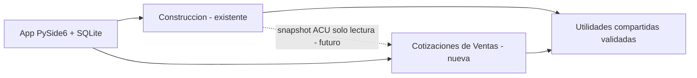

# IngePresupuestos — Diseño del producto con dos unidades de negocio

**Ruta de lectura oficial para humanos y agentes (24/10/2026).** Todo este directorio es documentación de diseño: el módulo Ventas NO está implementado ni aprobado para release.

## Empieza aquí

1. **[CONTEXTO MAESTRO Y 12 DIAGRAMAS](CONTEXTO-MAESTRO-Y-DIAGRAMAS.md)** — visión completa, esquema de BUs, experiencia, arquitectura, modelo de datos, cantidades/stock, cotizaciones, interoperabilidad, requisitos y hoja de ruta.
2. **[ADR-002 — Dos unidades de negocio](ADR-002-DOS-UNIDADES-DE-NEGOCIO.md)** — decisión de producto aceptada; preservar Construcción y añadir Cotizaciones de Ventas.
3. **[MK0 — Visión y alcance](MK0-VISION-Y-ALCANCE.md)** — tesis, problema, segmentos, mercado/viabilidad y riesgos.
4. **[MK1 — SRS candidato](MK1-SRS-CANDIDATO.md)** — 35 RF, 12 RNF, reglas, estados, pruebas y dudas abiertas; **no congelado**.
5. **[CONTRATO PARA AGENTES](CONTRATO-PARA-AGENTES.md)** — resumen de estado estructurado, restricciones, guías de reutilización, invariantes y plantilla de handoff.
6. **[Auditoría del sistema existente](../auditorias/AUDITORIA_TECNICA_2026-10-24.md)** — evidencia del baseline, GitHub Actions y deudas previas.

## Arquitectura visual ultrabreve

| Decisión | Estado |
|---|---|
| Dos unidades de negocio de primer nivel en una app | **APROBADO** |
| Mantener flujos/BD de Construcción y compatibilidad | **APROBADO** |
| Reutilizar matemática/formatos si hay equivalencia demostrada | **CANDIDATO** |
| Inventario comercial, cotizaciones, revisiones, catálogo SKU | **POR IMPLEMENTAR** |
| ACU paramétrico | **PROTOTIPO PR #1** |
| Estabilización global del fork | **PR #3 EN REVISIÓN** |
| Documento marco dual-BU | **PR #4 EN REVISIÓN** |
| Implementación Ventas / emisión fiscal / SaaS | **NO APROBADA / FUERA DEL MVP SEGÚN TEMA** |

### Cómo usar la documentación con una IA

Entregar a la IA el archivo **CONTRATO-PARA-AGENTES.md**, luego **CONTEXTO-MAESTRO-Y-DIAGRAMAS.md** y el ADR-002; pedirle que indique qué está **EXISTENTE / DECIDIDO / PROPUESTO / ABIERTO**, que consulte código real antes de tocarlo y que no implemente funciones sin gates cerrados.

**No mezclar:** stock de obra (por proyecto y consumo) con inventario comercial (por SKU y almacén); costo ACU con precio de venta; cotización con orden o factura; dimensión técnica con unidad vendible. Nunca comunicar ni contribuir al repositorio original; todo debe permanecer en `Em3rc0d/ingepresupuestos` y preservar derechos/licencia GPL.
